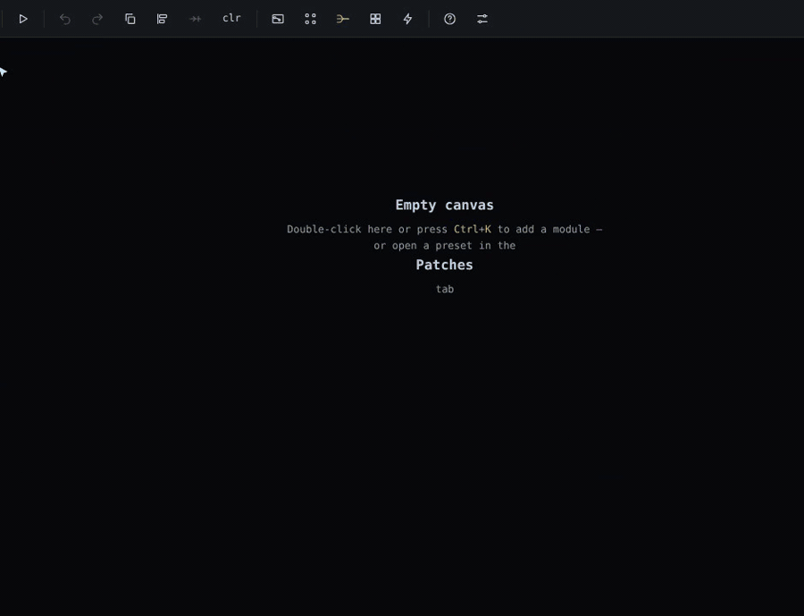
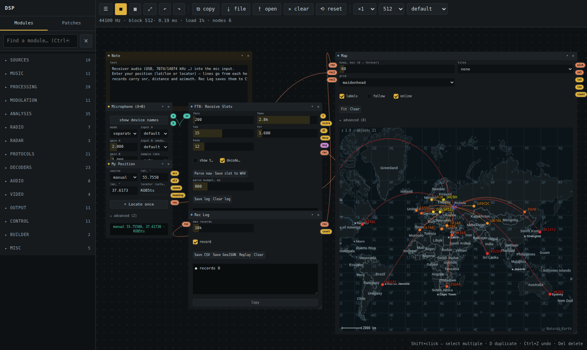
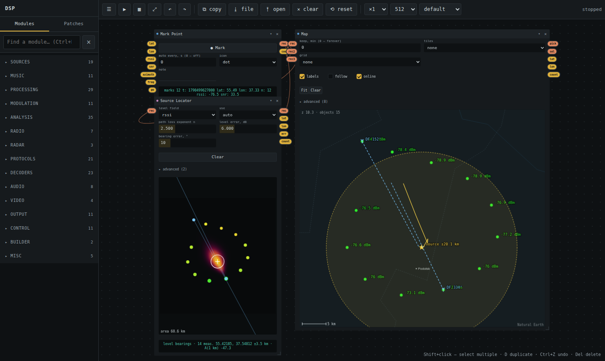
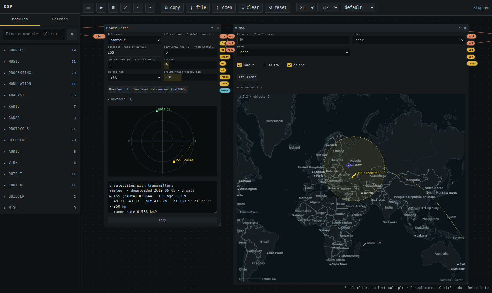

# DSP workbench

A browser-based modular DSP lab: build signal chains by wiring nodes on a canvas. Runs fully client-side, no build step, works offline as a PWA.

**[▶ Live demo](https://fagci.github.io/dsp/)** · **[📦 Releases](https://github.com/fagci/dsp/releases)** (signed Android app) · **[💛 Boosty — support the project](https://boosty.to/fagci)**

[](https://fagci.github.io/dsp/)

[More screenshots ↓](#screenshots)

## Features

- **A full DSP lab in the browser** — hundreds of modules wired on a canvas with typed ports: signal in → process → see, hear, decode. No install, no build step, works offline as a PWA.
- **Fuzzy everywhere, chains like Emmet** — the palette, the **Ctrl+K** command palette and the help search forgive typos and abbreviations (`phose` finds Phone sensors); build a chain by typing `mic>fft>sa`, with a live preview on the canvas before you press Enter, choose pins (`usb>sa[spec>spec, steerFreq<centerFreq]`), set parameters (`usb{sr:2.4M}`) and keep your own named **chunks** (`mysdr = usb*>sa[…]`, then `mysdr>demod`); `usb>(dac,sa,iqshift>iqdec>demod)` fans out branches from one module, and with a module selected Ctrl+K opens already with `>` to continue from it. The **Arrange graph** toolbar button lays the patch out in columns by signal flow.
- **Real radio** — USB SDRs (RTL-SDR, HackRF, Airspy, SDRplay, RX-888), remote SDRs (rtl_tcp over WebSocket or WebRTC, SpyServer, KiwiSDR, OpenWebRX), your own SDR shared as rtl_tcp (rtl_tcp Server: WebRTC or a TCP bridge for SDR++ / GQRX), any pin of the graph to the outside and back (Pins Out / Pins In / Pins (custom) over the bridge you already run (`tools/node/bridge.mjs` on a computer, the Android app or `tools/termux/bridge.mjs` on a phone) or WebRTC: channel IQ, spectrum, retuning from scripts and other devices; pins can be created by the other side), tinySA: [SDR and receivers](help/sdr.md)
- **The analysis bench** — spectrum, waterfall, oscilloscope, persistence, CFAR signal detector, band scanners, signal identification, **Air Diary** (days of band occupancy as an hour × frequency map; finds beacons, periodic and daily transmitters, feeds Table and Timeline): [Analysis](help/analysis.md)
- **Decoders as nodes** — CTCSS and DCS sub-tones and a DTMF-controlled repeater controller, Winlink over packet radio (AX.25 connected mode + B2F with LZHUF) (each with a test generator or a mirror), GSM, ADS-B, DMR, TETRA, POCSAG, AIS, ACARS, Inmarsat, JS8Call, digital voice and more, wired like any other module: [Radio](help/radio.md) · [Satellites](help/satellites.md)
- **Your phone is a node** — the Android app feeds GPS, Wi-Fi, BLE, cells and sensors (with the screen locked; accelerometer / gyro over the direct sensor channel: steady 800 Hz without jitter), scans networks, traces routes, sends sockets through Wi-Fi or mobile data as you choose and shows which network carries what, runs automations: [Phone](help/phone.md) · [Network](help/network.md)
- **Models on the phone** — the Android app runs whisper.cpp and llama.cpp itself (arm64 with dotprod, GPU through OpenCL on Adreno) and TensorFlow Lite on the GPU delegate (Notes and Sound Classifier, most phones): Speech to Text with the large-v3-turbo / medium models that actually know Russian (with a live draft while you speak), and the Ollama node with the host «app» chats with a GGUF model on the phone, token by token over the bridge: [Speech to Text](help/processing.md) · [Ollama on the phone](help/sources.md)
- **Records pipeline** — decoders emit records → Table, Graph, Map, entity rules, charts; **Geotag** glues a position (interpolated at the time of the record) to any record or number — a level map of a walk in two nodes: [Data](help/data.md) · [Map](help/map.md)
- **Video and cameras** — analog and digital TV (DVB-S/S2/T2), IP cameras and archives, camera tools, podcasts: [Video](help/video.md)
- **Health: sound and breath** — Noise Generator mixes white / pink / brown / blue / violet noise with generative rain, surf, wind, random chimes in a scale, thunder, a campfire, crickets, a heartbeat and a binaural / monaural / isochronic beat tone (no equalizer: the colour of a noise is its spectrum); Breath Pacer draws the breathing circle and a soft pitch cue and drives the surf with its `swell` output. Presets keep the lists in a Table — click a row: **Health: Binaural** (brain-wave bands, beat and carrier), **Health: Breath** (resonance, box, 4-7-8, physiological sigh…), **Health: Noise and Nature Mixer**, **Health: Camp Night**, **Health: Sleep Timer** (Sleep Timer fades the sound out and stops the engine; a Trigger Clock schedule can start it), **Health: Sunrise Alarm** (Sunrise Alarm: the light grows before the wake-up time — dark red to warm white, the phone screen becomes a lamp, `light` / `kelvin` / `color` for a real one — and the sound of a Noise Generator comes in later, to the full level at the set time; the night sound fades out under Sleep Timer), **Health: Chakra Tones** (Solfeggio and note-scale frequencies as pure tones, a tradition rather than science). Relaxation and focus aids, not medical devices.
- **Music** — tracker, sample editor, a Winamp-style player, Internet radio: [Media](help/media.md)
- **Out to the world** — serial (incl. Android OTG, and a port on a router / another PC through the Node bridge), Bluetooth LE, MQTT, messengers (Nostr, Matrix, Telegram, e-mail, IRC… with one address book of people and addresses kept in Tables), network text and bytes, WebRTC between browsers, firmware flashers: [Protocols](help/protocols.md)
- **Agents** — the Agent node lets a language model (an Ollama server or the model on the phone) act through any pin: you list what it may read, set and do in a few lines — every line makes a pin on the node, wired to anything (an oscillator, a ticker, a phone action, MQTT…); an action can return the answer of the graph, and by default asks your approval first; with a step limit, loop guard and clamped values: [Agent](help/sources.md)
- **Online data without keys** — weather and elevation (Open-Meteo), aircraft around a point (adsb.lol / OpenSky) next to your own ADS-B, active NWS weather alerts (CAP; with the same area / event filter as the SAME decoder and a relay to APRS bulletins and objects), OpenStreetMap objects (masts, towers, peaks) by tag, and a chat with a local model through Ollama that takes any text of the graph as context; the last answer is kept for offline and marked stale: [Sources](help/sources.md)
- **Wiring by thumb** — while you drag a wire (or after tapping a pin) the fitting pins light up and the rest dim, hidden pins that fit are revealed, and parameter rows with a pin socket are outlined; the wire snaps to the nearest fitting pin, so a finger over the target is enough, and a pill at the top shows the selected pin with a Cancel button. Sliders on a touch screen change only on a clear horizontal drag.
- **Wire probe and patch bundles** — hover a wire: a tip shows its ends and type, the last value, blocks per second and the age of the last block (only the source under the cursor is counted, so it costs nothing otherwise). **Settings → Patch bundle → Export…** saves the graph with the offline data you tick (models, dictionaries, the map) into one `.dspbundle`; Open file loads it and puts the data back, so the patch works on another device without a network.
- Around it all: a power profiler (the ⚡ button: bars of processing / drawing per module, a one-minute graph, peaks, heat outlines on the canvas), dashboards and tiles, undo, patches saved and shared by link, 160+ presets, installable offline app. **The full story — [the manual](help/README.md).**

## Manual

The full manual lives in [help/](help/README.md) — the same pages render here on GitHub, inside the app (the **?** button) and offline.

- **Getting started** — [Start here](help/start.md) · [Canvas and modules](help/canvas.md) · [Wires and port types](help/wires.md) · [Running and settings](help/run.md) · [Patches and presets](help/patches.md) · [Keys and gestures](help/shortcuts.md) · [Dashboard](help/dashboard.md)
- **Signals** — [SDR and receivers](help/sdr.md) · [Analysis](help/analysis.md) · [Radio: decoders and digital modes](help/radio.md) · [Satellites](help/satellites.md) · [Processing and interface](help/processing.md) · [Video and cameras](help/video.md) · [Media](help/media.md)
- **Data** — [Tables and records](help/data.md) · [Map and records](help/map.md)
- **Build and parse any packet** — HEX Structure: 170+ structures with Wireshark-style layering (Ethernet → IP → TCP/UDP → by port: HTTP, DNS, DHCP, NTP, TLS, MQTT, Modbus, CoAP, SIP, RTSP, WebSocket, HTTP/2, LLDP, VXLAN, GRE…), text protocols and your own JSON structures; Packet Analyzer filters like `http.method == "POST"`; Network bridge for a computer (`node tools/node/bridge.mjs`): [Protocols and firmware](help/protocols.md)
- **Hardware and protocols** — [Phone tools](help/phone.md) · [Network tools (Android app)](help/network.md) · [Protocols and firmware](help/protocols.md) · [Module reference](help/modules.md)
- **Operation** — [Offline and the phone app](help/offline.md)

## Screenshots

### Map: FT8 propagation

Heard stations from their locators, lines to your position, Maidenhead grid; colour — SNR.



### Source location (trilateration)

Fox hunt: RSSI marks along the route plus two bearings from a directional antenna; Source Locator shows the probability map and puts the estimate with its error radius on the map.



**Survey layer of the Map** (input `meas` from a Table of walk records: `dev`, `lat`, `lon`, `rssi`, `t`…): the walked track, a «Survey» panel with technology chips (Wi-Fi / BLE / BT / Cells), search, level and mark-count filters and a device list; click a device and the map flies to it and draws all its marks coloured by level with lines to the estimate. Preset «Map: Survey Explorer». Estimates of devices that are located too vaguely for their type (error radius over a per-type limit: Wi-Fi 60 m, BLE 40 m, Bluetooth 40 m, cells 1500 m; Map › Survey) are not drawn.

### Satellites

ISS: footprint, ground track ahead, sky plot, next passes and Doppler-corrected downlink.



### SDR software


### WeFax


### ft8


### RTTY


### Chirp modem (wip)


### Music making (wip)


### Generator + Oscilloscope


### Misc


## Proxy for KiwiSDR and lists

The **CORS proxy** from the settings panel is used for list downloads (Satellites, Station Schedule, SDR Receivers Directory…) and for the **KiwiSDR** and **OpenWebRX** nodes (OpenWebRX: `http://host:port/ws/`). For Kiwi the address `http://host:port/<ts>/SND` is substituted into the proxy URL the same way (`{url}` is replaced by the encoded address, otherwise the address is appended) and the scheme `http(s)` becomes `ws(s)`, so the proxy must pass WebSocket. Without a proxy the node connects to `ws://host:port` directly, which an https page cannot do (mixed content).

nginx, setting `https://example.com/proxy/` (the address is appended):

```nginx
# http {} block
map $http_upgrade $connection_upgrade { default upgrade; '' close; }

# server {} block
location ~ ^/proxy/(?<sch>https?):/+(?<hst>[^/]+)(?<pth>/.*)?$ {
    resolver 1.1.1.1;
    proxy_pass $sch://$hst$pth$is_args$args;
    proxy_http_version 1.1;
    proxy_set_header Host $hst;
    proxy_set_header Upgrade $http_upgrade;
    proxy_set_header Connection $connection_upgrade;
    proxy_ssl_server_name on;
    proxy_read_timeout 3600s;
    add_header Access-Control-Allow-Origin * always;
}
```

This is an open proxy to any host: restrict it (`allow`/`deny`, basic auth, or a whitelist of hosts) before exposing it. Lists need the CORS header, Kiwi only the WebSocket upgrade.

Pitfalls:
- The `location` prefix must match the one set in Settings (`/proxy/`, `/p/`…).
- An address with `.php` in the path (e.g. Celestrak `gp.php`) is caught by `location ~ \.php$` if that one comes earlier in the file: among regex locations the first match wins. Put the proxy `location` above it, otherwise you get a 404 without the CORS header.
- `always` in `add_header` is required: without it the header is not added to 4xx/5xx responses, and the browser shows "blocked by CORS policy" instead of the real error.
- Check: `curl -s -D- 'https://example.com/proxy/https://celestrak.org/NORAD/elements/gp.php?GROUP=amateur&FORMAT=tle' | head` — expect `200` and `Access-Control-Allow-Origin: *`.
