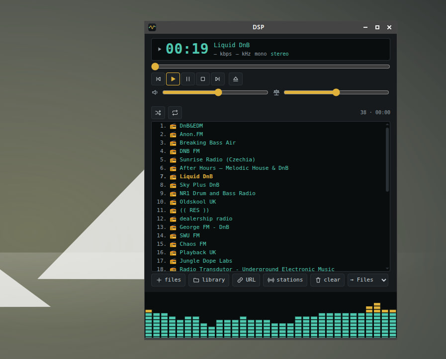

# The workbench

What the canvas and the UI around it can do.

### Workbench

- **Help** (the **?** button in the toolbar, **F1**, or the **?** in a module header; `modules/help.js`, logic in `modules/help-kernels.js`, `node tools/test-help.mjs`): the pages live in [`help/`](README.md) — plain Markdown, read here on GitHub and in the app from the same files, offline (they are in the service worker cache). One search box looks through the topics, the module list, the manual (this README, by section) and the presets, and it is **fuzzy**: typos and abbreviations find things (`grph`, `spectrm`, `netwrk lan`). The same fuzzy search now works in the module palette, the module picker and the patch list. A module card (the **?** in its header, or select a module and press F1) is built from the module itself — pins with their types and tips, parameters with defaults — plus the module's paragraph of this README and the presets that use it, with *Add to canvas*. `help/modules.md` is the same reference as a file (`node tools/gen-modref.mjs`). Add a page: a `.md` file in `help/` and a line in `help/README.md`. Preset «Help: Your First Patch».
- Node graph editor: pan/zoom canvas, drag-and-drop modules, typed ports (signal, number, spectrum, image, text, block, IQ stream)
- Dashboard view (split panes, draggable dividers) for building instrument-like UIs
- **Tiles-only mode**: open the app with `?readonly-tiles` (e.g. `index.html?readonly-tiles#p=My patch`) — only the tiles are shown, no sidebar, toolbar, pane headers or graph; layout and graph cannot be edited or moved, hotkeys are off, the mode is not saved. Pressing any button on a source module while the engine is stopped starts it
  - As a standalone window, only the player: `google-chrome --app="https://fagci.github.io/dsp?readonly-tiles=1"` (pin the module to a tile first)

    
- **Module graph** pane in the dashboard: the regular node canvas inside a tile, next to the modules opened in other panes (SunVox-style) — see [Module graph pane](processing.md#module-graph-pane)
- **Detail levels (LOD)**: double-tap a module's title to collapse it to a compact card (title only), to a **dot** (a circle with initials; the full name shows on hover / when selected) or back to full. Service modules (the auto adapters *IQ → Audio*, *I/Q → IQ*) are added as dots. The **detail** button in the toolbar switches all modules at once: full → compact → dots. The level is saved in patches
- **Power profile** (⚡ in the toolbar): CPU share of every module (processing + drawing) as a badge on the module and a top-10 list, the total, and battery drain (%/h, where `navigator.getBattery` exists). Click a row to freeze a module. **skip unused** (on by default) does not compute modules whose result nobody uses: no display and no wire to a used module (outputs, sources and control modules are always kept)
- **Quick chain** (**→+** in the toolbar, enabled when one module is selected): the picker opens for the module's free signal output (a module without one — its free signal input, e.g. Sound Card), lists only what fits, connects the new module and selects it, so the next tap continues the chain — a receiver or a patch can be built with taps alone, without dragging wires
- **Module picker**: search takes several words (all must match title / id / category; titles starting with a word rank first). Drop a wire on an empty spot — or select a port and tap an empty spot — and the picker lists only modules that have a matching port, shows which pin the wire will go to and connects it on pick; modules that need an automatic *iq* ↔ signal adapter come after the exact matches. Every module gets a generated icon: initials on the category colour, the shape follows the main output type (circle — IQ, diamond — spectrum, square — records / text / images, hexagon — no outputs)
- **Wire bundles**: wires are bundled by topology, not by geometry. A module with two or more wires on one side gathers them into one harness at that side — they fan out at the pins, lie 3 px apart along the trunk and part only near their targets; wires from one module to different modules share the trunk, wires from different modules into one module converge before it. Each wire stays separate (its own colour, hover, click to delete). Automatic and independent of where the targets are: modules stacked vertically, close together or behind (a wire going backwards) are bundled as well. The toolbar button (wires icon) turns it off; the choice is remembered
- Add modules right on the canvas: double-click an empty spot (or **+** in the graph pane) and search
- Groups (nested subgraphs) with custom inputs/outputs
- Undo/redo, duplicate, multi-select, module search — from the toolbar; hotkeys: **Space** (run / stop), **Ctrl+K** or **/** (command palette: modules and patches by a fuzzy search — or a chain, `mic>fft>sa`, built with a live preview on the canvas), **Ctrl+S** (save), **Ctrl+A** (select all), **arrows** (nudge the selected modules), **+** / **−** (zoom), **Delete** (removes the selected modules) and **Ctrl+Z** / **Ctrl+Shift+Z** (undo / redo); the full list — **?** or [help/shortcuts.md](shortcuts.md). Patches from the side list can be **dragged onto the canvas** (or inserted with **＋**) — they are added to the current graph, not replacing it, and one Ctrl+Z takes them back
- Save/load patches to local storage or JSON files
- 160+ built-in presets: demos, quick scenarios, radio protocols, music, analysis
- Adjustable block size, sample rate and run speed (×1…×32); redraw rate switch in the settings panel (the sliders button in the toolbar, together with run speed, block size, sample rate, **All data → Export… / Import…** and the global **CORS proxy** used by Satellites, Horizon and Station Schedule — `{url}` in it is replaced by the encoded address, otherwise the address is appended): *fps max* (default; always 60 fps — the waterfall does not slow down at rest, but the main thread has less time for USB and audio), *fps auto* (60 → 30 → 20 fps as the interface sits idle, 10 fps with a USB SDR connected) and *fps min* (10 fps, lightest on CPU)
- AudioWorklet engine, SharedArrayBuffer path when cross-origin isolated
- Installable PWA with offline support; app badge while the engine runs; autosave runs in idle time under a Web Lock (no double saves from two tabs); `prefers-reduced-motion` is respected
- **Offline data** (`OfflineData` in `modules/filestore.js`): big files that modules download once — the Object Detect model and TF.js (~19 MB, `vendor/objdet/`), the JS8 text dictionary, the Natural Earth basemap — are kept in *Files → Offline data* (see the size, delete, export, or put your own file with the same name). Items marked `auto` (the JS8 dictionary and the basemap) are also fetched quietly ~20 s after start when online (not on cellular, not in data-saver mode); Object Detect loads on first use. The *⇩ offline* button in Files lists everything worth having without a network (Object Detect model, JS8 dictionary, basemap, cities, satellite TLE and SatNOGS transmitters) with a ✓ for what is already stored, and downloads the selected items; every item also has a **by hand** box for when the network is blocked: links to the sources (opened in a new tab; the app's own files such as the basemap and the JS8 dictionary are saved with a click) and *choose file…* to put the downloaded file back — models and libraries go to Files → Offline data under the right name, cities (GeoNames JSON / dump / CSV), SatNOGS transmitters (JSON) and each CelesTrak TLE group are checked and stored in their own storage (a wrong file is refused); modules add their own with `OfflineData.fileItem` / `OfflineData.item` (an `item` gives `manual()` links and `ingest(file, entry)`). They are not synced between devices and are not duplicated in the service-worker cache.
- Large patches stay smooth: nodes outside the screen are not laid out or painted (`content-visibility: auto`, enabled per node after its first layout so the size is remembered; on a 128-node test patch 4–7 → 28–54 fps)
- Built-in performance counters (long tasks/frames, slow input events, `Perf.time` marks, device profile) are appended to the error report (`core-perf.js`)
